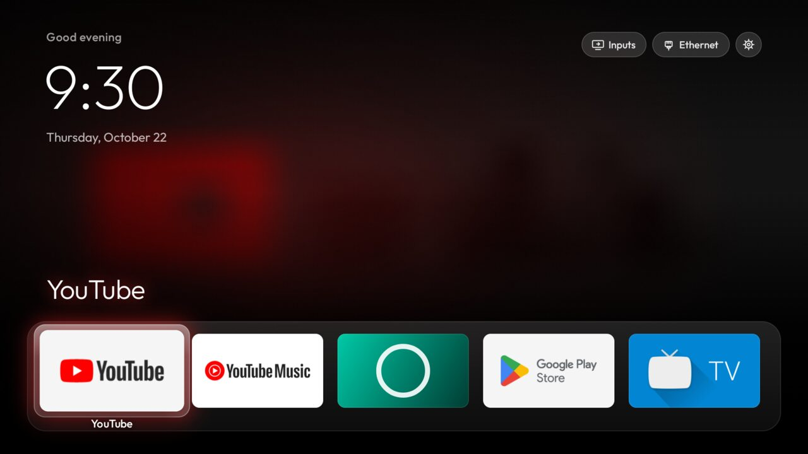
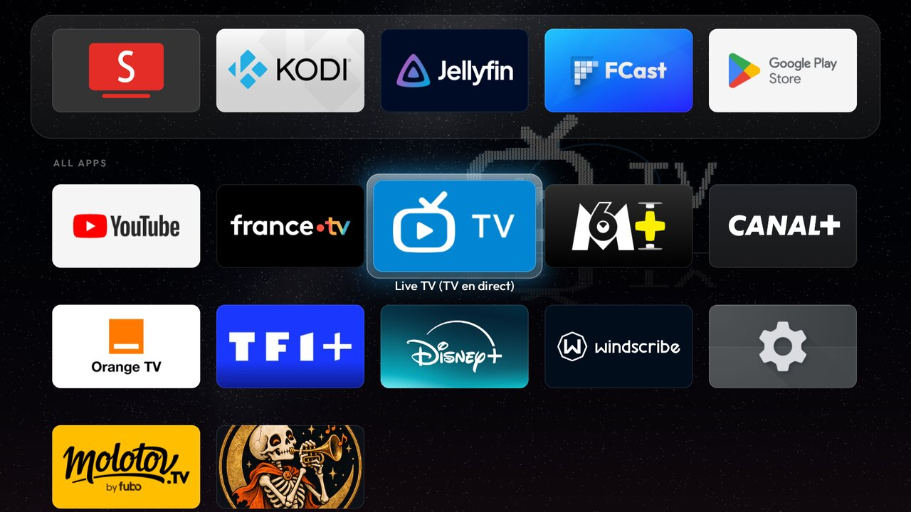
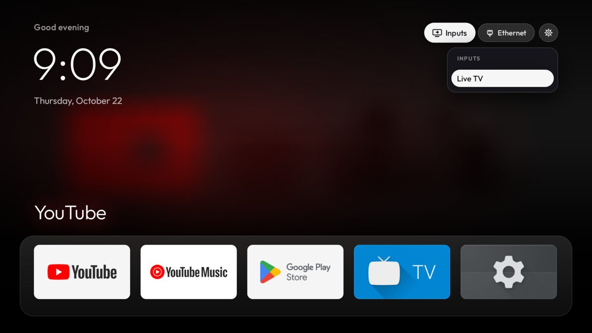

# tv-lab

Debloat an Android TV / Google TV and replace its home screen with **Lumen**, an Apple TV 4K style
launcher, everything reversible. Built on a local Android TV 14 emulator, then run on a real
Thomson 4K Google TV.

Inspired by the wave of "I vibe-coded my TV" posts (x.com/SimbasJungles/status/2112231637840765012) and
the open-source [CleanYourTV](https://github.com/Gathin23/cleanyourtv) project, whose safety rules
(disable never uninstall, back up first, never touch core packages, Home guard) this follows.

| All apps | Inputs | Screensaver |
|---|---|---|
|  |  |  |

## Lumen

- Hero backdrop: a soft colour wash of the focused app's banner with an ambient glow sampled from it,
  cross-fading as focus moves
- Greeting, thin Outfit clock and date; frosted pills for Inputs (glass dropdown: Live TV + HDMI
  inputs via the TV input framework), network (Wi-Fi name or Ethernet) and Settings
- Glass dock band of 5 apps, a spring-animated glass highlight, focused tile lifts with a real shadow
  and shows its name; all apps in a grid below that scrolls the dock up like tvOS
- Deterministic D-pad: Up/Down move exactly one row, Up from the dock reaches the top bar, Back
  returns to the dock, Home always lands on the dock; last focus remembered across restarts
- Long-press OK (or Menu) to rearrange: arrows move the tile, OK saves
- Lumen Clock screensaver: thin drifting clock, moves every minute against burn-in
- Remote keys: on Google TV the remote's Input, YouTube, Netflix and Disney+ buttons are wired to the
  stock launcher; an accessibility service (`LumenKeys`) takes them while Lumen is on screen
- Plain Java, no dependencies, no INTERNET permission, 156 KB APK, minSdk 26

## Layout

| Path | What |
|---|---|
| `debloat.txt` | Packages disabled on the emulator image (Google TV ads, recommendations, telemetry, preloads) |
| `lists/thomson-4k-ratv3.txt` | The real TV's list, in batches, with what was kept and why |
| `mise.toml` | Pinned JDK 17 and Android SDK command-line tools |
| `scripts/backup.sh` | Captures packages, settings, getprop, Home and screensaver before any change |
| `scripts/disable.sh` | Disables a list, one `pm disable-user` per package, refuses protected core packages |
| `scripts/install.sh` | Builds Lumen, installs it, makes it Home, disables the stock launcher only behind a guard that re-enables it if Lumen does not take Home |
| `scripts/restore.sh` | Re-enables everything, gives Home back, restores the screensaver, uninstalls Lumen (`--keep-lumen` to keep it) |
| `scripts/measure.sh`, `scripts/frames.sh` | Reboot + RAM measurement, D-pad frame-time measurement |
| `lumen/` | Launcher source; `lumen/build.sh` builds with the bare SDK (aapt2, javac, d8, apksigner) |
| `backup/` | Per-TV state written by `backup.sh` and the other scripts; gitignored (holds serials and device names) |
| `shots/` | Verification screenshots; gitignored |

## Requirements

`adb` and [mise](https://mise.jdx.dev). `mise install` brings JDK 17 and the SDK command-line tools,
then once: `mise exec -- sdkmanager "build-tools;34.0.0" "platforms;android-34"`. Run the scripts
through `mise exec --` so `ANDROID_HOME` and Java are set. JDK 17 matters: d8 from build-tools 34
crashes on classes compiled by newer JDKs. `lumen/build.sh` creates `~/.android/debug.keystore` if it
is missing. To try it without a TV: an emulator from `system-images;android-34;android-tv;x86`
with the `tv_1080p` device.

## Results on the emulator (Android TV 14, 1 GB RAM)

Measured the same way for both: reboot, settle 90 s, `dumpsys meminfo`; 30 D-pad presses, `dumpsys gfxinfo` (host GPU).

| | Stock | Lumen + debloat |
|---|---|---|
| Home app PSS | ~90 MB (`tvlauncher`) | 26 MB (-71%) |
| Used RAM | 732 MB | 633 MB (-99 MB) |
| Running processes | 392 | 325 |
| Frame time p50 / p90 / p99 | 18 / 23 / 31 ms | 19 / 25 / 32 ms |

Lumen renders about 5x more frames than stock (springs, cross-fades) at the same frame pacing. It is
not "3x faster"; it is the same speed while doing a lot more, on a third of the memory.

## Results on the real TV (Thomson 4K Google TV, Android 14, 1.7 GB RAM)

Product `Thomson_4K_RATV3`, device `cottongreen`, Realtek, 32-bit ARM, build `UKRC.260302.020`.
Same method; 29 packages disabled (`lists/thomson-4k-ratv3.txt` plus `launcherx` and `setupwraith`).

| | Stock | Lumen + debloat |
|---|---|---|
| Home app PSS | 194 MB (`launcherx` 177 + `:coreservices` 18) | 82 MB (-58%) |
| Also gone | `setupwraith` 22 MB, Anoki ACR 15 MB | |
| Used RAM | 1,213 MB | 1,035 MB (-178 MB) |
| Frames on 30 D-pad presses | 35 | 714 |
| Frame time p50 / p90 / p99 | 10 / 22 / 34 ms | 13 / 14 / 16 ms |

The stock home barely redraws on D-pad and stutters when it does; Lumen animates every move and its
worst frame is half the stock one. `ps -A` went 410 -> 419, but about 280 of those are kernel
threads and only ~15 are apps, and the count moves by tens between runs: it does not measure the
debloat.

Checked on the TV with screenshots: Home is Lumen after a reboot and all 29 packages stay disabled;
D-pad from every edge; Inputs lists Live TV, AV and HDMI 1-4 and switches; rearrange and launch/return
work; Live TV opens the Realtek tuner (no channels scanned yet, so it opens the scan).

## Things learned the hard way

- On this Google TV build `cmd package set-home-activity` and the HOME role both report success and
  change nothing: the stock launcher's HOME filter has priority 2, which beats any preferred choice.
  Lumen only becomes Home once the stock launcher is disabled, hence the guarded swap in `install.sh`.
- `adb shell` inside a `while read` loop eats the loop's stdin; the first restore re-enabled one
  package out of nine. `restore.sh` reads the list up front.
- The first backdrop painted seven full-screen layers per frame. It is now composed once per focus
  change, off the UI thread, into a 480x270 bitmap and blitted as one texture.
- On the Thomson, setupwraith's `RecoveryActivity` claims HOME at priority 1, above any sideloaded
  launcher, and it owned the saved Wi-Fi networks (`dumpsys wifi | grep cname=`): disabling it would
  have deleted them and dropped ADB. Forgetting and re-joining the network in Settings moved it to
  `android.uid.system`; `install.sh` now refuses to disable a Home rival that owns Wi-Fi networks.
  The shell cannot disable a single component there ("Shell cannot change component state").
- Forgetting the network also switched Network debugging off; it had to be re-enabled on the TV.
- A reboot a few seconds after `pm disable-user` lost two of the changes: package state is written
  to disk lazily. Wait ~30 s before rebooting.
- The remote's buttons never reach the Home app. Google's handler wraps every app button and Input
  in a broadcast to launcherx; Realtek's sends YouTube to launcherx because the build has
  `AMATI_EXPERIENCE`, unless a read-only vendor config flag is set. With launcherx disabled they
  silently do nothing. `LumenKeys` filters them first, but any accessibility key filter stops held
  keys from repeating (volume up held went one step instead of 20 -> 31), so the filter is only
  requested while Lumen is in front. From inside an app: Home, then the button. Checked with the real
  remote: Input, YouTube and Disney+ work from Home, and held volume ramps (20 -> 35) inside YouTube.
- YouTube came up signed out although both Google accounts are still on the TV: Google TV hands
  YouTube's profile choice to launcherx (`com.google.android.gms.account.ProfilePickerDelegation`),
  which nothing answers once launcherx is disabled.
- `adb shell input keyevent` does not go through accessibility key filters, so testing them needs the
  real remote.

## On a real TV

1. TV: Settings > Device Preferences > About > press Build 7 times, then Developer options > USB
   debugging (and Network debugging if shown). Note the TV's IP.
2. `adb connect <tv ip>:5555`, accept the prompt on the TV, then `export ANDROID_SERIAL=<tv ip>:5555`.
3. `scripts/backup.sh` (package list, settings, getprop, Home, screensaver); it refuses to overwrite an existing `backup/`.
4. Build a list for *that* TV: manufacturer packages differ from this emulator. Check the matching
   folder in CleanYourTV's `examples/` first; never disable what the TV needs (TV/input apps, remote,
   Bluetooth, keyboard, Play Store/Services, core Android).
5. `scripts/disable.sh <list>` in small batches with a screenshot after each; check Live TV and HDMI.
6. On Google TV, check `cmd package query-activities -a android.intent.action.MAIN -c
   android.intent.category.HOME` and `dumpsys wifi | grep cname=`. If a Home claimant other than the
   stock launcher owns the Wi-Fi networks, forget and re-join the network in Settings first.
7. `mise exec -- scripts/install.sh`, wait ~30 s, reboot, and check Home and `pm list packages -d`.
8. Press every remote button with the real remote (Input, app buttons, mic, Live TV, held volume).
9. When done: turn USB/Network debugging off on the TV.

Undo everything: `scripts/restore.sh`.

## Status

Done on the emulator and on the Thomson (`192.168.5.200`, reached from a machine on the same
`192.168.5.x` subnet; the first machine on `192.168.42.x` could not reach it through the UniFi
gateway). Backup in `backup/`, undo with `scripts/restore.sh`.
